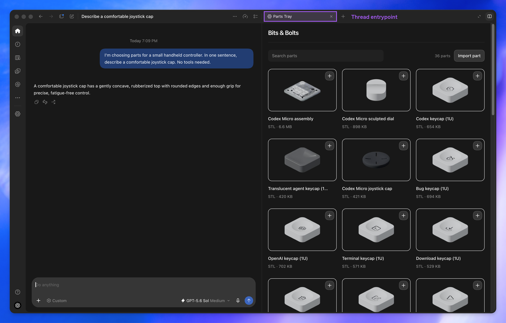
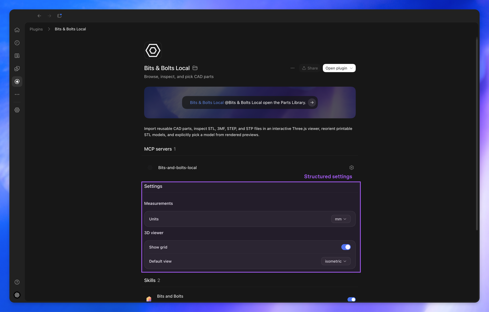
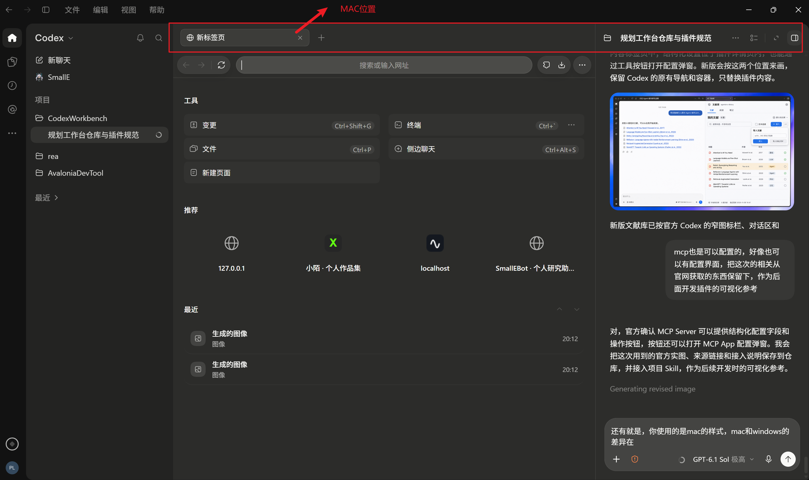
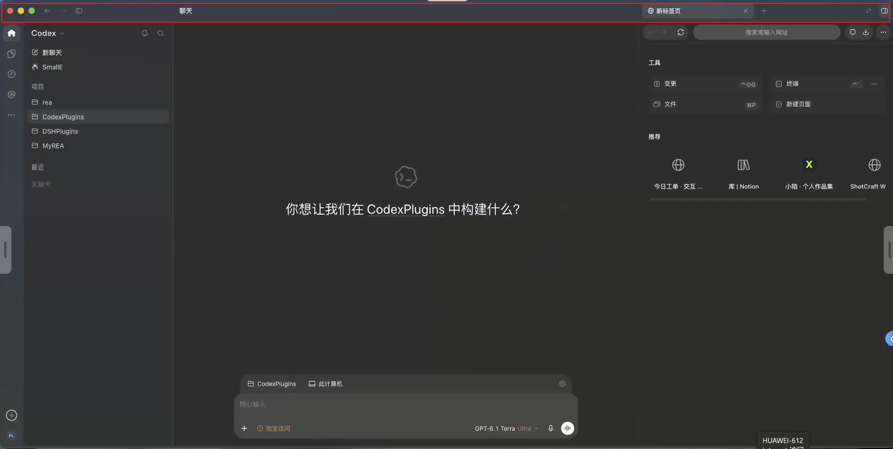

# Codex 插件界面参考

整理日期：2026-11-08。用于后续插件原型、Thread 入口与配置页面开发。

官方图片用于核对公开扩展容器；用户提供的 Windows／macOS 截图用于核对实际宿主外观。它们是参考资料，不代表本项目已实现或在所有版本中验证了对应功能。

## 官方实图

图片原样保留自 OpenAI 的 `mcp-extensions` 仓库，固定参考提交为 `39f91ad0bdf1435aadb879172ab2467d0e97cead`。

### Thread 内容标签页

图中应用位于对话旁的内容标签页。容器和标签属于宿主，插件负责里面的界面；不能从该示例推导出所有布局中应用都固定在右侧。

[原始图片](https://github.com/openai/mcp-extensions/blob/39f91ad0bdf1435aadb879172ab2467d0e97cead/docs/resources/02-thread-tray.png) · [入口协议](https://github.com/openai/mcp-extensions/blob/39f91ad0bdf1435aadb879172ab2467d0e97cead/docs/spec.md#thread-entrypoint)

### 插件详情与结构化设置

设置位于插件详情页中。图片里的紫色边框和英文标注是文档注释，不是需要实现的宿主控件。

[原始图片](https://github.com/openai/mcp-extensions/blob/39f91ad0bdf1435aadb879172ab2467d0e97cead/docs/resources/07-settings-entrypoint.png) · [设置协议](https://github.com/openai/mcp-extensions/blob/39f91ad0bdf1435aadb879172ab2467d0e97cead/docs/spec.md#structured-settings)

## 用户提供的 Windows／macOS 对照

两张图保留用户原有红框与箭头，供定位差异，不把注释画进最终产品。

### Windows

重点看顶部的“文件／编辑／视图／帮助”菜单，以及下方内容标签和对话标题所在的行；保留 Windows 窗口控件的位置。

### macOS

重点看顶部标题、内容标签的位置与红黄绿窗口控件。不能把此宿主样式直接当作 Windows。

侧栏可以展开或收起，内容与对话也可左右调整。两张截图中的这些状态差异不应被固化为操作系统差异。插件内容区可以共用，顶部菜单、导航和窗口控件由宿主提供。

## 已核实的配置机制

- MCP Server 声明 `openai/settings`，指定读取与更新设置的工具。
- 读取工具提供 schema、值和布局；更新工具接收变更字段；服务端负责保存。
- 原生字段支持布尔、字符串、枚举及数值。
- 布局可以加入工具按钮。普通工具返回执行反馈，MCP App 工具可以在设置页面上打开配置弹窗。

因此可以使用“原生简单字段 + 打开配置与诊断”的组合，无需让用户手改 `mcp.json` 来完成日常业务设置。

这些行为来自固定提交的官方协议；实施时仍需核对使用的 SDK、桌面版本和实际能力。文献插件的 CLI 路径、Vault 路径及正文读取开关属于本项目的产品设计，不是官方固定字段。

## 使用这些参考出图

1. 先选择目标平台与实际宿主布局。
2. 将相应原图作为 ImageGen 输入，标清宿主参考和插件可设计区域。
3. 保留宿主导航、工具栏、输入框、内容标签与窗口控件的结构，只设计合法的插件内容区或配置弹窗。
4. DSH 可以提供文献交互思路，不作为 Codex 外壳参考。
5. 生成图是设计稿，不能当作真实宿主截图或实现验收证据。

## 来源与许可

- [官方扩展总览](https://developers.openai.com/plugins/build/extensions)
- [固定提交的完整协议](https://github.com/openai/mcp-extensions/blob/39f91ad0bdf1435aadb879172ab2467d0e97cead/docs/spec.md)
- [TypeScript SDK 接入示例](https://github.com/openai/mcp-extensions/blob/39f91ad0bdf1435aadb879172ab2467d0e97cead/typescript/README.md)
- 两张官方图片按上游 Apache-2.0 许可保留，附 [上游许可证原文](UPSTREAM-LICENSE.txt)；平台对照图来自用户本次提供的附件。
